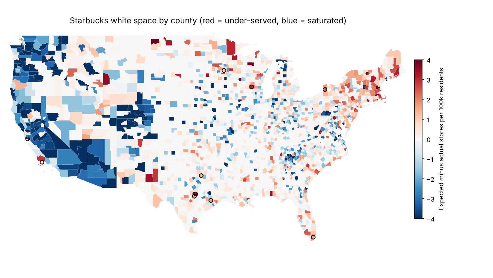
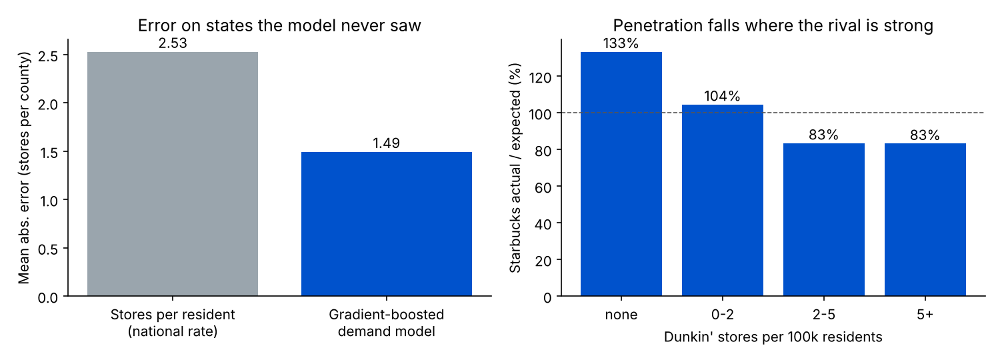

# Retail Site Selection: Where Should a Store Chain Open Next?

A location-intelligence model that answers the question every retail expansion team asks: **which markets can support more stores than we have today, and where is the competition weak?**

Using **13,608 Starbucks** and **4,898 Dunkin'** locations across **3,108 US counties**, it:

1. maps every store to its county with point-in-polygon geometry,
2. learns how many stores a county's population, education, job mix and age profile can support,
3. checks that the model works on **states it has never seen**,
4. measures the **white space** (expected minus actual stores) and tests whether a rival chain explains it,
5. ranks the under-served counties where the rival is also weak.



*Red counties have fewer stores than their demographics support; blue counties have more. Circles mark the top 10 uncontested opportunities.*

## Key results

| Area | Finding |
|---|---|
| Demand model | On states held out of training, the model cuts mean error from **2.53 to 1.49 stores per county (−41%)** versus a stores-per-resident baseline, and raises Poisson deviance explained from **86.7% to 93.5%**. It separates counties that have a store from those that do not with an AUC of **0.96**. |
| What drives demand | After population size, the strongest signals are the **share of food-service jobs** (a proxy for eating-out and visitor traffic), **share of adults with a bachelor's degree** and **professional-services jobs** (office workers). Income alone adds little once these are known. |
| White space | Counties hold **~1,660 fewer stores** than their demographics support. **120 counties** are short by 3 or more stores. |
| Competition | In counties large enough to judge, Starbucks has **133% of its expected stores where Dunkin' is absent** but only **83% where Dunkin' has 2+ stores per 100k residents**. The pattern holds within the eastern US alone (**116% vs 83%**), so it is not just a West vs East effect. |
| Where to open | **56 uncontested counties** (gap of 3+ stores, under 1 Dunkin' per 100k) add up to **~550 stores** of unmet demand across **37 million residents**, led by Harris (Houston), Dallas and Miami-Dade. |



### Top 10 uncontested counties

| County | Population | Starbucks | Expected | Gap | Dunkin' |
|---|---:|---:|---:|---:|---:|
| Harris, TX | 4.66M | 221 | 292.8 | 71.8 | 6 |
| Miami-Dade, FL | 2.71M | 100 | 144.0 | 44.0 | 20 |
| Dallas, TX | 2.62M | 120 | 161.2 | 41.2 | 8 |
| Erie, NY | 0.92M | 22 | 45.5 | 23.5 | 3 |
| Williamson, TX | 0.55M | 23 | 43.4 | 20.4 | 0 |
| Travis, TX | 1.23M | 65 | 85.1 | 20.1 | 3 |
| Dane, WI | 0.54M | 18 | 33.7 | 15.7 | 0 |
| Hennepin, MN | 1.25M | 77 | 90.4 | 13.4 | 0 |
| Santa Barbara, CA | 0.45M | 24 | 36.8 | 12.8 | 0 |
| Santa Cruz, CA | 0.27M | 17 | 28.5 | 11.5 | 0 |

The full ranking of all 3,108 counties is in `results/county_white_space.csv`.

## Method

**Store to county.** Each store's latitude and longitude is tested against 3,221 county boundary shapes (bounding-box pre-filter, then point-in-polygon). 13,570 of 13,608 stores map to a county; the other 38 sit on coastlines, where rounded coordinates fall just offshore.

**Demand model.** The target is stores per 100k residents, fitted with a Poisson `HistGradientBoostingRegressor` weighted by population and scaled back to a store count. Modelling the rate rather than the raw count lets expected stores grow with county size instead of being capped by the biggest training counties. Features are demographics and jobs only (population, density, income, bachelor's degree share, poverty, age mix, unemployment, housing cost, jobs per resident in five sectors). **Latitude, longitude and competitor counts are deliberately left out**, so "expected" means what the local market can support, not where the brand already happens to be.

**Validation.** 5-fold cross-validation grouped by state: every county's expected store count comes from a model that never saw any county in its state. The white space is computed only from these out-of-state predictions, so a county's own store count never leaks into its expectation.

**Competition test.** For the 389 counties with at least 5 expected stores, penetration = actual ÷ expected stores, compared across bands of Dunkin' density, for the whole country and again for the eastern US only.

## Limitations

- The store lists are snapshots from 2017–2018 (Starbucks store directory and a Dunkin' locator scrape published in TidyTuesday). The Dunkin' list has about 4,900 stores, roughly half the chain's US estate at the time, so Dunkin' density is a relative signal, not a full count.
- White space at county level says *which market*, not *which street*. The next step is the same model at ZIP or neighbourhood level with footfall and rent data.
- Some gaps have reasons the data cannot see, such as local taste, real-estate availability or a strong regional rival other than Dunkin'. The ranking is a shortlist for field validation, not a final decision.

## Run it

```bash
pip install pandas numpy scikit-learn matplotlib
python run_analysis.py   # writes results/results.json and results/county_white_space.csv (~20 s)
python make_charts.py    # writes results/white_space_map.png and results/summary.png
```

## Data sources

- Starbucks and Dunkin' locations: TidyTuesday 2018-05-07 "Coffee chains" (`rfordatascience/tidytuesday`), US rows only.
- County demographics, income, education, jobs and cost of living: `evangambit/JsonOfCounties` (Census, BEA, BLS, USDA, County Business Patterns, MIT Living Wage), trimmed to the columns used.
- County boundaries: `plotly/datasets` `geojson-counties-fips.json` (US Census).
